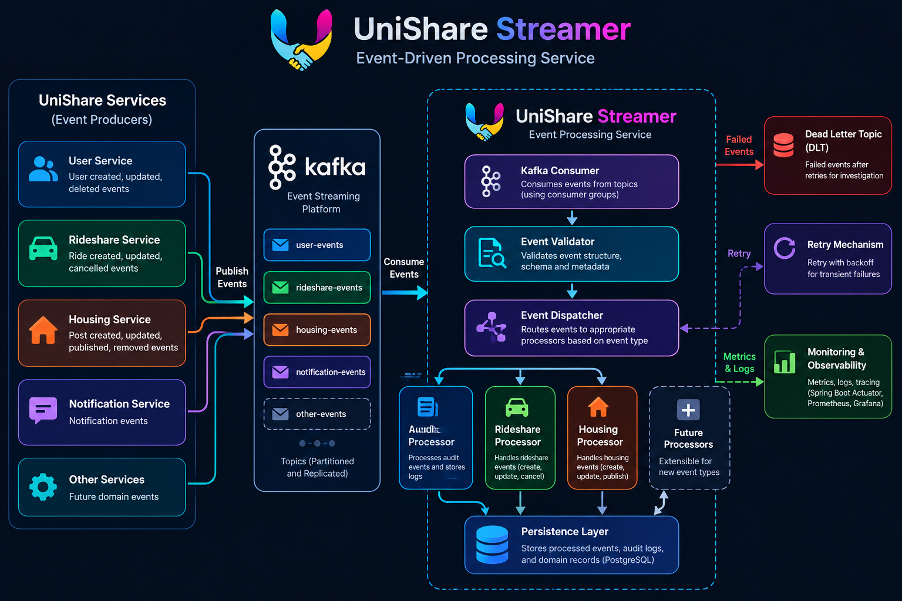

# UniShare Streamer

<div align="center">


### Event-Driven Processing Service for UniShare

**Java 21 · Spring Boot · Apache Kafka**

</div>

---

## Overview

UniShare Streamer is a dedicated backend service within the UniShare ecosystem, designed to process events asynchronously using Apache Kafka and Spring Boot.

It acts as a centralized event-processing layer, allowing different UniShare services to publish events without being tightly coupled to the services responsible for processing them.

The service is intended to handle audit events, ridesharing events, housing-post events, and future domain-specific events through a scalable, reliable, and extensible event-driven architecture.

## Why UniShare Streamer?

As the UniShare platform grows, application services need to handle more than their primary business operations. Audit logging, activity tracking, and other secondary operations can introduce additional database queries, processing overhead, and dependencies between services.

UniShare Streamer addresses these challenges by separating event production from event processing.

### Problems It Solves

- **Tight coupling:** Services publish events without directly depending on downstream processors.
- **Processing overhead:** Producers do not need to wait for asynchronous event processing to finish.
- **Distributed audit handling:** Provides a centralized place to process audit events from multiple services.
- **Scalability limitations:** Event consumers can scale independently of event producers.
- **Failure isolation:** Processing failures can be handled independently through retries and recovery mechanisms.
- **Limited extensibility:** New event types can be added through dedicated processors without redesigning the entire system.

## Core Functionalities

### 1. Centralized Event Processing

Consumes events from Kafka and dispatches them to appropriate handlers based on event type and domain.

### 2. Audit Event Processing

Processes events representing important application operations to support centralized audit logging.

Potential audit information includes:

- Actor or user responsible for an operation
- Entity or resource affected
- Operation performed
- Event timestamp and correlation ID
- Relevant event metadata

### 3. Rideshare Event Processing

Supports event-driven processing for ridesharing workflows, including ride creation, updates, cancellations, and other lifecycle events as integrations are implemented.

### 4. Housing Event Processing

Supports housing-post lifecycle events, such as creation, modification, publication, and removal, as required by the platform.

### 5. Extensible Event Architecture

Supports the introduction of new event types through a structured event contract and dedicated processors, keeping domain logic separated.

### 6. Reliability and Observability

The service is designed to incorporate:

- Structured logging and correlation IDs
- Consumer health checks and processing metrics
- Retry handling for transient failures
- Dead-letter topics for failed messages
- Idempotent processing to prevent duplicate side effects
- Graceful shutdown and controlled message consumption

These capabilities should be considered available only after their implementation and verification.

## Architecture

<div align="center">



</div>

The intended event flow is:

1. UniShare services publish events to Kafka.
2. Kafka stores events in configured topics.
3. UniShare Streamer consumes and validates the events.
4. Events are dispatched to audit, rideshare, housing, or other processors.
5. Processors perform the required operations and persist results where configured.
6. Failures are handled through appropriate retry and recovery mechanisms.

## Demo

<div align="center">


</div>

*Add an animated demonstration of the service, such as application startup, Kafka event consumption, or event-processing logs.*

## How Apache Kafka Is Used Efficiently

Apache Kafka serves as the event transport and buffering layer between UniShare's producing services and UniShare Streamer.

### Event Processing Lifecycle

1. **Produce:** A UniShare service publishes an event after a relevant business operation.
2. **Buffer:** Kafka stores the event according to the topic's retention and replication configuration.
3. **Consume:** UniShare Streamer receives the event through a configured consumer group.
4. **Dispatch:** The service routes the event to the appropriate processor.
5. **Process:** The handler validates the event and performs the required operation.
6. **Commit:** Consumer offsets are committed according to the processing and delivery strategy.
7. **Recover:** Failed messages are retried or routed to a dead-letter topic when appropriate.

### Efficiency and Reliability Strategies

- **Consumer groups:** Distribute partitions across consumer instances to support parallel processing.
- **Partitioning:** Select keys based on the required ordering boundary, such as an entity ID.
- **Producer batching and compression:** Improve throughput by reducing request overhead and network traffic.
- **Controlled concurrency:** Tune polling, batch sizes, and processing concurrency according to workload requirements.
- **Safe offset commits:** Avoid committing offsets before the corresponding work reaches the intended completion point.
- **Idempotent consumers:** Use stable event IDs or database constraints to prevent duplicate side effects.
- **Retry and dead-letter handling:** Apply bounded retries with backoff and isolate messages that repeatedly fail.
- **Schema evolution:** Maintain versioned, compatible event contracts as services evolve.
- **Transactional outbox:** Reliably publish database-backed events without depending on an unsafe dual-write operation.
- **Monitoring and backpressure:** Track consumer lag, processing latency, errors, retries, and dead-letter volume.

### Delivery Guarantees

The intended design favors reliable at-least-once consumption with idempotent processing.

Exactly-once behavior across Kafka and an external database is not automatic and requires appropriate transactional or deduplication mechanisms.

## Technology Stack

| Technology | Purpose |
|---|---|
| Java 21 | Primary programming language |
| Spring Boot | Application framework |
| Apache Kafka | Event streaming and messaging |
| Maven | Build and dependency management |
| Spring Boot Actuator | Health checks and monitoring |
| PostgreSQL | Persistence for processed records where required |

## Getting Started

### Prerequisites

- JDK 21
- Maven or the included Maven Wrapper
- Apache Kafka, locally or through a reachable broker
- Git

### Clone the Repository

```bash
git clone https://github.com/PravinChoudhary11/unishare-streamer.git
cd unishare-streamer
```

### Configure the Application

Configure local settings in `src/main/resources/application-local.yaml`.

Typical configuration includes:

- Application port
- Kafka bootstrap servers
- Consumer group ID
- Kafka topic names
- Database connection details, if persistence is enabled

Keep credentials and sensitive values outside version control. Use environment variables or a secret-management solution for production configuration.

### Run Locally

**Windows PowerShell**

```powershell
.\mvnw.cmd spring-boot:run "-Dspring-boot.run.profiles=local"
```

**Linux/macOS**

```bash
./mvnw spring-boot:run -Dspring-boot.run.profiles=local
```

### Build the Application

**Windows**

```powershell
.\mvnw.cmd clean package
```

**Linux/macOS**

```bash
./mvnw clean package
```

## Development Principles

- Separate event transport, dispatching, and domain-processing logic.
- Keep event contracts explicit, stable, and versionable.
- Design consumers to tolerate retries, duplicate deliveries, and rebalances.
- Never log passwords, access tokens, or secrets.
- Test event handlers, failure paths, and recovery behavior.
- Provide observability through logs, metrics, and health indicators.
- Document Kafka topics, schemas, partitioning, and operational configuration.

## Development Team

| Role | Name | Responsibilities |
|---|---|---|
| Developer | **Rakesh Choudhary** | Implementation, event processors, testing, and maintenance |
| Main Supervisor | **Axiom** | Technical supervision, architectural direction, code reviews, and development guidance |

## Project Status

**Under Development**

UniShare Streamer is being developed incrementally as the event-processing layer for the UniShare platform. The capabilities described in this README represent the intended design; individual processors, persistence integrations, and reliability mechanisms should be considered available only after implementation and testing.

## License

The project license has not yet been specified. Add a `LICENSE` file when the licensing terms are decided.

---

<div align="center">

**UniShare Streamer**

*Decoupled event processing for a scalable UniShare ecosystem.*

</div>